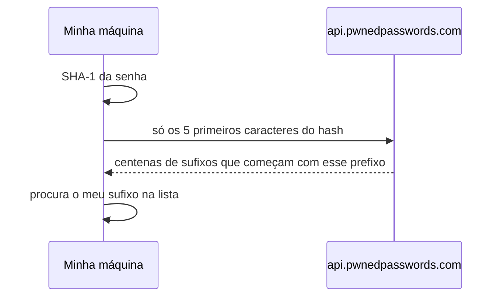

<p align="center"><sub>Password Auditor</sub></p>

---

<p align="center">
  
</p>

<p align="center">
  Mede a força real de senhas e consulta o Have I Been Pwned com k-anonymity
</p>

<p align="center">
  
  
  <a href="https://github.com/arthurlynow098/password-auditor/actions/workflows/testes.yml"></a>
  
</p>

## Sobre o projeto

Todo site tem aquela barrinha que fica verde quando você coloca uma letra maiúscula e um número. O problema é que `Senha@2024` deixa a barrinha verde e cai em qualquer ataque de dicionário em segundos.

Fiz o Password Auditor para medir a força **de verdade**. Ele calcula a entropia, desconta os padrões que um atacante testa primeiro (palavra comum com leetspeak, ano no final, sequência de teclado, informação pessoal) e ainda consulta o **Have I Been Pwned** para saber se a senha já apareceu em algum vazamento, sem mandar a senha para lugar nenhum.

## Como funciona



## Tecnologias

<p>
  
  
  
</p>

## Executando o código

Não precisa instalar nada além do Python 3.10 ou mais novo.

```bash
git clone https://github.com/arthurlynow098/password-auditor.git
cd password-auditor

# analisa (a senha é digitada escondida, não fica no histórico do terminal)
python -m auditor

# analisa e consulta vazamentos, avisando quais informações pessoais procurar
python -m auditor --hibp --info arthur sorocaba 2004

# gera uma frase-senha com 6 palavras
python -m auditor --gerar 6
```

Testes

```bash
pip install -r requirements-dev.txt
python -m pytest -q
```

Os testes do HIBP usam uma função falsa no lugar da API, então rodam sem internet e ainda conferem que só 5 caracteres saem da máquina.

## Exemplo

```text
  senha para analisar (não aparece na tela) **********

  força   █░░░░  muito fraca
  bits    0.0 efetivos de 51.7 brutos (10 caracteres)

  ALERTA  essa senha apareceu 132.268 vezes em vazamentos. Troque agora.

  problemas encontrados
   x tem só 10 caracteres, o NIST recomenda aceitar senhas longas e o ideal é 12 ou mais
   x está (ou é variação de algo que está) nas listas de senhas mais usadas
   x contém uma informação pessoal (flamengo)

  tempo estimado para quebrar
   online com limite de tentativas   3 minutos
   online sem limite                 na hora
   offline com bcrypt                na hora
   offline com MD5 em GPU            na hora
```

A senha do exemplo era `flamengo10`. Pela conta ingênua ela teria 51 bits, mas na prática vale zero.

## Estudei por aqui

Segui essas aulas e materiais para entender e aplicar tudo que está aqui.

| Material | O que tirei dele |
|---|---|
| [OWASP Authentication Cheat Sheet](https://cheatsheetseries.owasp.org/cheatsheets/Authentication_Cheat_Sheet.html) | Regras de senha que fazem sentido e as que só atrapalham |
| [NIST SP 800-63B](https://pages.nist.gov/800-63-3/sp800-63b.html) | Recomendação oficial sobre tamanho mínimo e checagem contra vazamentos |
| [Documentação da API do Have I Been Pwned](https://haveibeenpwned.com/API/v3) | Como funciona o endpoint de range e o cabeçalho de padding |
| [TryHackMe, Hashing Crypto 101](https://tryhackme.com/room/hashingcrypto101) | SHA-1, salt e por que hash rápido é ruim para senha |
| [OWASP Password Storage Cheat Sheet](https://cheatsheetseries.owasp.org/cheatsheets/Password_Storage_Cheat_Sheet.html) | bcrypt, Argon2 e os números usados na estimativa de tempo |

## Licença

Distribuído sob a licença MIT. Veja o arquivo [LICENSE](LICENSE).

<p align="center"><sub>A gravura do banner é o tatu do Royal Natural History de Richard Lydekker, de 1894, em domínio público no <a href="https://commons.wikimedia.org/wiki/File%3AThreeBandArmadilloLyd.jpg">Wikimedia Commons</a>.</sub></p>
