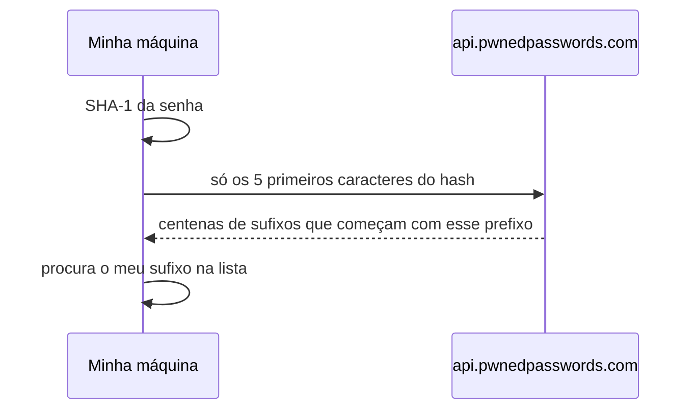

<a id="top"></a>

<p align="center"></p>

<p align="center">


<a href="https://github.com/arthurlynow098/password-auditor/actions/workflows/testes.yml"></a>

</p>

<p align="center"><a href="#sobre">Sobre</a> &nbsp;&nbsp; <a href="#como-funciona">Como funciona</a> &nbsp;&nbsp; <a href="#rodando">Rodando</a> &nbsp;&nbsp; <a href="#aprendi">O que aprendi</a> &nbsp;&nbsp; <a href="#estudos">Estudos</a></p>

<a id="sobre"></a>

<p></p>

Todo site tem aquela barrinha que fica verde quando você coloca uma letra maiúscula e um número. O problema é que `Senha@2024` deixa a barrinha verde e cai em qualquer ataque de dicionário em segundos.

Fiz o Password Auditor para medir a força **de verdade**. Ele calcula a entropia, desconta os padrões que um atacante testa primeiro (palavra comum com leetspeak, ano no final, sequência de teclado, informação pessoal) e ainda consulta o **Have I Been Pwned** para saber se a senha já apareceu em algum vazamento, sem mandar a senha para lugar nenhum.

<a id="como-funciona"></a>

<p></p>

**1. Entropia bruta.** Tamanho da senha vezes log2 do tamanho do alfabeto usado. É a conta que a maioria dos medidores faz e para por aí.

**2. Desconto de padrões.** Aqui está a parte interessante. O programa procura

| Padrão | Exemplo | Por que pesa |
|---|---|---|
| Senha comum ou variação dela | `S3nh@2024!` vira `senha` | Wordlists com regras de leet testam isso primeiro |
| Sequência | `1234`, `abcd`, `9876` | Está em todo dicionário |
| Caminho de teclado | `qwer`, `asdf` | Mesma coisa |
| Repetição | `aaa`, `abcabc` | Reduz muito o espaço de busca |
| Ano ou data | `1999`, `150398` | Primeiro chute de quem te conhece |
| Informação pessoal | seu nome, time, cidade | Engenharia social básica |

**3. Consulta ao HIBP com k-anonymity.** Essa foi a parte que mais gostei de entender.



A API nunca vê a senha nem o hash completo. Ela só sabe que você perguntou sobre um prefixo que é compartilhado por centenas de senhas diferentes.

**4. Tempo para quebrar.** Calculo para quatro cenários, de um login com limite de tentativas até um hash MD5 vazado sendo atacado por GPU. Isso mostra por que o jeito que o site guarda a senha importa tanto quanto a senha em si.

**5. Gerador de frase-senha.** Usa o módulo `secrets` (e não o `random`, que é previsível) para sortear palavras de uma lista em português.

<a id="rodando"></a>

<p></p>

Não precisa instalar nada além do Python 3.10 ou mais novo.

```bash
git clone https://github.com/arthurlynow098/password-auditor.git
cd password-auditor

# analisa (a senha é digitada escondida, não fica no histórico do terminal)
python -m auditor

# analisa e consulta vazamentos, avisando quais informações pessoais procurar
python -m auditor --hibp --info arthur sorocaba 2004

# gera uma frase-senha com 6 palavras
python -m auditor --gerar 6
```

Testes

```bash
pip install -r requirements-dev.txt
python -m pytest -q
```

Os testes do HIBP usam uma função falsa no lugar da API, então rodam sem internet e ainda conferem que só 5 caracteres saem da máquina.

<p></p>

```text
  senha para analisar (não aparece na tela) **********

  força   █░░░░  muito fraca
  bits    0.0 efetivos de 51.7 brutos (10 caracteres)

  ALERTA  essa senha apareceu 132.268 vezes em vazamentos. Troque agora.

  problemas encontrados
   x tem só 10 caracteres, o NIST recomenda aceitar senhas longas e o ideal é 12 ou mais
   x está (ou é variação de algo que está) nas listas de senhas mais usadas
   x contém uma informação pessoal (flamengo)

  tempo estimado para quebrar
   online com limite de tentativas   3 minutos
   online sem limite                 na hora
   offline com bcrypt                na hora
   offline com MD5 em GPU            na hora
```

A senha do exemplo era `flamengo10`. Pela conta ingênua ela teria 51 bits, mas na prática vale zero.

<a id="aprendi"></a>

<p></p>

- Entropia de verdade depende de como o atacante chuta, não só do alfabeto
- Como funciona k-anonymity e por que dá para consultar um vazamento sem expor nada
- Diferença entre `random` e `secrets` e por que isso importa em segurança
- O que o NIST SP 800-63B fala sobre senha (tamanho importa mais que regra de símbolo)
- Por que hash rápido como MD5 é péssimo para guardar senha e bcrypt ou Argon2 resolvem

Limitações que eu sei que existem

- A lista de senhas comuns é pequena, uma wordlist como a rockyou tem 14 milhões de entradas
- Palavras fora da lista, como `Tr0ub4dor&3`, ainda ganham nota maior do que deveriam
- Quero integrar a biblioteca zxcvbn no futuro para comparar os resultados

<a id="estudos"></a>

<p></p>

Segui essas aulas e materiais para entender e aplicar tudo que está aqui.

| Material | O que tirei dele |
|---|---|
| [OWASP Authentication Cheat Sheet](https://cheatsheetseries.owasp.org/cheatsheets/Authentication_Cheat_Sheet.html) | Regras de senha que fazem sentido e as que só atrapalham |
| [NIST SP 800-63B](https://pages.nist.gov/800-63-3/sp800-63b.html) | Recomendação oficial sobre tamanho mínimo e checagem contra vazamentos |
| [Documentação da API do Have I Been Pwned](https://haveibeenpwned.com/API/v3) | Como funciona o endpoint de range e o cabeçalho de padding |
| [TryHackMe, Hashing Crypto 101](https://tryhackme.com/room/hashingcrypto101) | SHA-1, salt e por que hash rápido é ruim para senha |
| [OWASP Password Storage Cheat Sheet](https://cheatsheetseries.owasp.org/cheatsheets/Password_Storage_Cheat_Sheet.html) | bcrypt, Argon2 e os números usados na estimativa de tempo |

<p align="center"><sub>Parte do <a href="https://github.com/arthurlynow098">Lince Lab</a>, minha coleção de projetos de cibersegurança</sub></p>

<p align="center"><a href="#top">Voltar ao topo</a></p>
